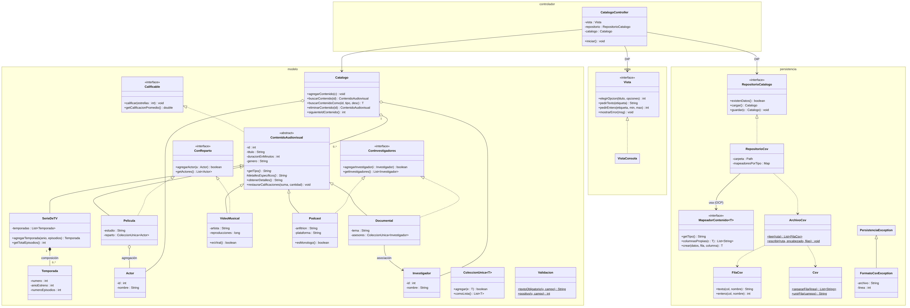

# Sistema de Contenido Audiovisual — Programación Limpia

**Universidad Politécnica Salesiana – Ingeniería en Software**
Programación Orientada a Objetos – Unidad 4: Programación Limpia
Estudiante: Andy Javier Ortiz Valdiviezo · Docente: Gustavo Navas Ruilova

## Descripción

Aplicación de consola en Java que administra un catálogo de contenido audiovisual: películas, series de TV, documentales, videos musicales y podcasts, junto con sus actores, temporadas e investigadores.

Este proyecto parte del sistema de la Unidad 2 ([POO-U2-AndyOrtiz](https://github.com/soyandyortiz/POO-U2-AndyOrtiz)). En esta unidad se le agregó lectura y escritura de archivos **CSV**. Además, el código se refactorizó con principios de **código limpio** y **SOLID**, se reorganizó con el patrón **MVC** y se cubrió con **pruebas unitarias JUnit 5**.

## Cambios realizados en esta unidad

### Etapa 1 · Manejo de archivos (CSV)
- Los datos se leen y se guardan en la carpeta `datos/`, en seis archivos:

  | Archivo | Contenido |
  |---|---|
  | `contenidos.csv` | Un registro por contenido, con su tipo, datos comunes, calificaciones y columnas propias |
  | `actores.csv`, `investigadores.csv` | Personas registradas |
  | `temporadas.csv` | Temporadas de cada serie (composición) |
  | `reparto.csv`, `asesores.csv` | Relaciones contenido–actor y contenido–investigador |

- Al iniciar, el programa carga los CSV. Desde el menú se puede guardar (opción 16) o recargar (opción 17), y al salir pregunta si se quieren guardar los cambios.
- Para guardar se escribe primero un archivo `.tmp` y luego se reemplaza el original, así un error no deja el CSV a medias.
- Los campos con comas o comillas se escriben entre comillas (formato estándar RFC 4180).
- Si una línea tiene un error, se lanza `FormatoCsvException` indicando **archivo, número de línea y columna**. Ejemplo: `contenidos.csv, línea 3: 'abc' no es un número válido en la columna 'duracion'`.

### Etapa 2 · Refactorización y código limpio
- Se eliminó el contador `static` de IDs: ahora `Catalogo` asigna el siguiente ID, y así los IDs se conservan al cargar desde el archivo.
- Se eliminó código duplicado:
  - `ColeccionUnica<T>` reemplaza la lógica de "agregar sin repetir", que estaba copiada en cuatro clases.
  - `Validacion` reúne las validaciones que se repetían.
  - `TextoDetalle` arma las secciones de texto de los detalles.
- Se separaron los métodos largos: el controlador tiene un método pequeño por opción del menú, y `RepositorioCsv` tiene un método por archivo.
- Se renombró lo que no era claro y se quitaron los comentarios redundantes; los que quedan explican el *porqué*.
- El modelo ya no imprime en consola (`mostrarDetalles()` se reemplazó por `obtenerDetalles()`).

### Etapa 3 · Principios SOLID

| Principio | Aplicación |
|---|---|
| SRP | `Catalogo` gestiona los datos, `RepositorioCsv` los archivos, `VistaConsola` la entrada/salida y `CatalogoController` coordina. |
| OCP | Cada tipo de contenido tiene su `MapeadorContenido`: para guardar un tipo nuevo se agrega un mapeador, sin modificar `RepositorioCsv`. El menú se arma con un mapa de opciones. |
| LSP | Las 5 subclases respetan el contrato de `ContenidoAudiovisual` (ninguna lanza `UnsupportedOperationException`). `PolimorfismoLiskovTest` lo verifica. |
| ISP | En lugar de una interfaz grande hay tres pequeñas: `Calificable`, `ConReparto` (Pelicula, VideoMusical) y `ConInvestigadores` (Documental, Podcast). |
| DIP | `CatalogoController` depende de las interfaces `Vista` y `RepositorioCatalogo`, que se inyectan por constructor en `Main`. En las pruebas se reemplazan por una vista simulada y un repositorio en memoria. |

### Etapa 4 · Patrón MVC

- **Modelo**: paquete `modelo`, con las clases de negocio y el `Catalogo`.
- **Vista**: paquete `vista`, con la interfaz `Vista` y `VistaConsola`, que tiene un menú de 17 opciones.
- **Controlador**: paquete `controlador`, con `CatalogoController`.
- **Persistencia**: paquete `persistencia`, para los archivos CSV.

### Etapa 5 · Pruebas unitarias (JUnit 5)

- **97 pruebas** en la carpeta `test/`, en 12 clases de prueba. Usan `@Test`, `@ParameterizedTest`, `@TempDir`, `assertThrows` y `assertInstanceOf`.
- Cubren los casos normales, los límites y los excepcionales:
  - Límites: 0 y 6 estrellas, 999 999 y 1 000 000 reproducciones.
  - Archivos: CSV dañados, IDs inexistentes y temporadas no consecutivas.
- Cobertura medida con JaCoCo / EclEmma: **98 % de líneas** del código (excepto `Main`).

## Estructura del proyecto

```
├── src/
│   ├── app/            Main (arma las dependencias)
│   ├── controlador/    CatalogoController
│   ├── modelo/         ContenidoAudiovisual, Pelicula, SerieDeTV, Documental, VideoMusical, Podcast,
│   │                   Actor, Temporada, Investigador, Catalogo, Calificable, ConReparto,
│   │                   ConInvestigadores, ColeccionUnica, Validacion
│   │   └── excepciones/ ElementoNoEncontradoException
│   ├── persistencia/   RepositorioCatalogo, RepositorioCsv, MapeadorContenido, Mapeadores,
│   │                   ArchivoCsv, FilaCsv, Csv, PersistenciaException, FormatoCsvException
│   └── vista/          Vista, VistaConsola
├── test/               pruebas JUnit 5 (mismos paquetes que src/)
├── datos/              archivos CSV de ejemplo
└── docs/               diagrama de clases (PNG y fuente Mermaid)
```

## Diagrama de clases



## Cómo clonar y ejecutar

**Requisitos:** JDK 17 o superior y Eclipse IDE for Java Developers, que ya incluye JUnit 5.

1. Clonar el repositorio:
   ```
   git clone https://github.com/soyandyortiz/POO-U4-AndyOrtiz.git
   ```
   También se puede descargar con *Code → Download ZIP*.
2. En Eclipse: *File → Import → General → Existing Projects into Workspace* y elegir la carpeta del proyecto.
3. Ejecutar `src/app/Main.java` con *Run As → Java Application*. El programa lee los CSV de la carpeta `datos/`.

## Cómo ejecutar las pruebas

- **Todas las pruebas:** clic derecho en la carpeta `test` → *Run As → JUnit Test*.
- **Cobertura:** clic derecho en `test` → *Coverage As → JUnit Test*.

Si Eclipse marca que falta JUnit: clic derecho en el proyecto → *Build Path → Add Libraries → JUnit → JUnit 5*.
